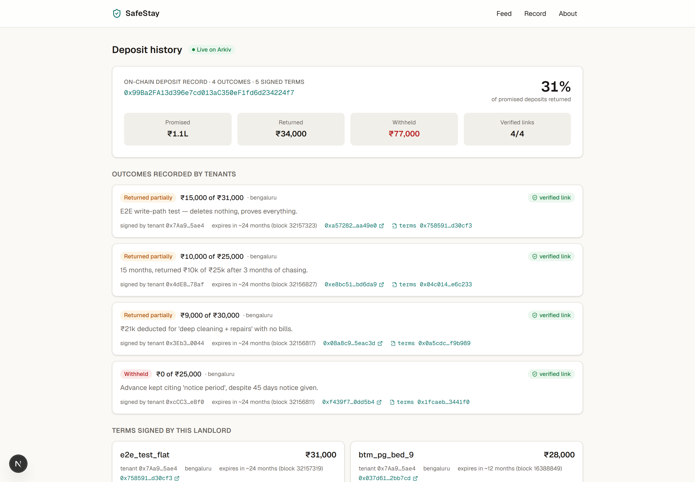
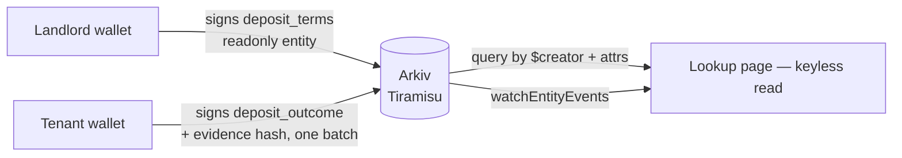

# SafeStay

> Check a landlord's deposit history on Arkiv before you hand over ₹50,000. Signed, queryable, impossible to edit after the fact.

[**▶ Live demo**](https://safestay-demo.vercel.app) · Demo video: see Devfolio submission · [Schema](arkiv/schema.md) · [Friction report](arkiv/friction.md)



## The problem

Indian renters pay deposits and PG advances — ₹20k to ₹1L+ — before they have any
verifiable history on the person taking the money. In Bengaluru, Mumbai, Pune and
Hyderabad the standard complaint is the same: "deep cleaning + repairs" deductions
with no bills, or the deposit that never comes back at all. Every platform that could
host this record (a reviews site, a broker, a housing app) can also edit it.

## What it does

- **Paste a landlord's wallet → see promised vs returned.** The money shot: a
  landlord who signed ₹1.1L in deposits and returned ₹34,000 shows as 31%, with the
  withheld amount in red — computed from entities they cannot alter.
- **Landlord signs deposit terms.** Amount, tenant wallet, move-in date and refund
  window go on-chain as a `readonly` Arkiv entity — immutable after signing.
- **Tenant records the outcome + evidence hash in one batch.** What was actually
  returned, plus a SHA-256 of a photo/chat screenshot (the file itself never
  leaves the device), written atomically in a single `executeBatch` transaction.
- **Everything links both ways.** An outcome only counts as *verified* when the
  terms it references name that same tenant wallet — you can't plant a fake
  outcome against a landlord without their signature on the terms.

## Demo walkthrough

1. Open the app → paste (or click) a seeded landlord, e.g. **Sunrise PG**
   `0x99Ba2F…24f7` → the deposit history appears. No wallet, no signup.
2. Read the aggregate card: promised, returned, withheld, verified-link count,
   expiry countdown per record.
3. Click any `terms 0x…` or outcome key → opens the Tiramisu explorer and shows
   the entity's real creator address and attributes.
4. Go to **Record** → pick the open terms for the demo tenant → choose
   "Returned partially" → submit. Outcome and evidence hash land in *one*
   Arkiv transaction.
5. Back on the landlord page, the green **Live on Arkiv** badge streams the new
   entity in over WebSocket — no refresh.

## How it works



The hard part is the **cross-creator link**: terms name the tenant, the outcome
references the terms, and the tenant is the outcome's creator. Filtering by
`$creator` (not by a writable `author` field) is what makes fake reviews cost a
colluding landlord's signature — the Security-pillar requirement, verbatim.

Payloads carry only public text (property note, outcome note) and the evidence
SHA-256. Names and photos never touch the chain.

## Built with

| Layer | Choice | Why |
|---|---|---|
| Data layer | `@arkiv-network/sdk` 0.8.1 on Tiramisu | Records must outlive and out-trust any operator — that's the product |
| App | Next.js 16 (App Router, Server Actions) + TypeScript | Server-side signing; keyless public reads for judges |
| Styling | Tailwind CSS v4, design tokens in `globals.css` | One accent, one typeface, no hardcoded colors |
| Icons | lucide-react | One icon library |
| Validation | zod on every server action input | Inputs checked before any wallet call |

## What's real vs. mocked

| Piece | Status |
|---|---|
| All landlord/tenant records | **Real Arkiv entities** on Tiramisu, seeded by burner wallets (see `scripts/seed.ts`, `scripts/seed-results.json`) |
| The landlord/tenant identities | **Synthetic** — demo wallets generated for seeding; the footer says so. No real people are named |
| Wallet connection | **Demo-mode** — the app signs as the seeded wallets so judges can write real entities without installing a wallet. The signer key is server-side, never in the browser |
| Photo evidence | **Hash only** — the file stays on-device; its SHA-256 is what goes on Arkiv |
| Live updates | **Real** — `watchEntityEvents` over WebSocket, filtered to `project=safestay_v1` |

## Run it locally

```bash
git clone <repo> && cd safestay
npm ci
cp .env.example .env.local   # fill in — see below
npm run seed                 # optional: re-seed (needs a funded Tiramisu wallet)
npm run dev                  # http://localhost:3000
```

**Env vars** (all in `.env.local`, all server-side):

| Var | Source | Degrades without it |
|---|---|---|
| `ARKIV_MASTER_KEY` | any funded Tiramisu burner (faucet: hub.arkiv.network/faucet) | Writes disabled; lookup pages still read live data |
| `SEED_LANDLORD_*`, `SEED_TENANT_*` | generated by `scripts/seed.ts` | Seeded landlords won't resolve on the lookup page |

## Known limitations

- **No pagination beyond `MAX_HISTORY = 40`** — Arkiv has no `ORDER BY`; we fetch a
  bounded set and sort in memory. A production version wants an indexer.
- **Expiry is ~30 months by design** — records outlive a tenancy but aren't
  permanent; Lifetime Extension renews them while a tenancy is active.
- **No identity verification** — a landlord's wallet is a pseudonym, not a KYC'd
  person. Tying wallets to verified identity (e.g. an attestation layer) is the
  obvious next step.
- **Demo-mode signing** — real tenants would connect their own wallet; we sign
  server-side so the demo needs no install.

## Licences

MIT © 2026 DruxAMB — see [LICENSE](LICENSE). Third-party packages are under their
own licences (Next.js MIT, Tailwind MIT, viem MIT, Arkiv SDK MIT, lucide-react ISC).
